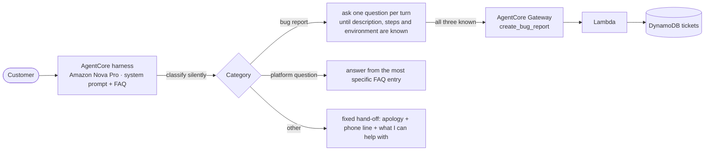

# Customer support chatbot on Amazon Bedrock AgentCore

A support chatbot that does three things well:
- **files bug reports**: it asks for any missing details first, then creates a ticket through an AgentCore Gateway tool;
- **answers shop questions** strictly from an FAQ;
- **hands everything else to human support.**

It's built on AgentCore's managed **harness** with Amazon Nova Pro, and driven by a single, carefully engineered system prompt. It was evaluated with **Bedrock Evaluations (LLM-as-a-judge)**: mean correctness went from **0.969 to 1.000** after one round of prompt changes.


> Final project of the *Prompting for Effective LLM Reasoning* course in Udacity's
> [Future AWS Agent Engineer Nanodegree](https://www.udacity.com/scholarships/aws-ai-ml-scholars).
> My notes and the other projects from the program: **[aws-agent-engineer-notes](https://github.com/ahmedEid1/aws-agent-engineer-notes)**.

## Origin

Built for the Future AWS Agent Engineer Nanodegree on Udacity's starter code (`project/starter` in [udacity/aws-c1-prompting-llm-reasoning-nd905-cd14762-project](https://github.com/udacity/aws-c1-prompting-llm-reasoning-nd905-cd14762-project/tree/main/project/starter)).

- **From the starter, unchanged:** both CloudFormation templates, the bug-report Lambda (`create_bug_report.py`), `setup_gateway.py`, `create_harness.py`, `cleanup_agentcore.py`, `requirements.txt` and the FAQ (`online_shop_faq.md`).
- **From the starter, changed by me:** `chat.py` and `generate-eval-dataset.py`. Both now give each conversation its own memory actor, and the dataset script strips `<thinking>` text before judging.
- **Mine:** the system prompt (the starter's `system_prompt.txt` held only instructions and the `{{FAQ}}` placeholder), the 16 test cases in `harness-tests.json` (the starter had a one-entry template), `multiturn_bug_test.py`, `record_chat.py`, the datasets, judge output and multi-turn results in `evaluation/`, and the write-up, transcripts and screenshots in `docs/`.

## How it works



Example (from the [full transcript](docs/transcripts/chat_bug_report.txt), with Nova's `<thinking>` spans left out):

```text
you> Hi, the Add to cart button isn't working on your website.
bot> I'm sorry about that. What steps did you take before the "Add to cart" button stopped working?
you> I open a product page, pick a size and click Add to cart, but nothing happens.
bot> Thank you. Which browser, operating system and device were you using?
you> I'm using Firefox 131 on Windows 11, on my desktop PC.
[tool call] bugreports___create_bug_report
bot> The bug has been reported and your ticket ID is 0fa96020-7169-4d15-9990-1aa891b982c5.
     Thank you for helping us improve our website.
```

## The prompt engineering

The whole behavior lives in [`chatbot/system_prompt.txt`](chatbot/system_prompt.txt). What made it reliable:

- **Silent classification first.** Every request is sorted into bug report / platform question / other before the reply. Edge cases are spelled out: a broken item or a declined card is a shop question, not a website bug.
- **A strict tool contract.** Nova Pro kept calling `create_bug_report` on the first message with invented values ("unknown", made-up steps, even a question as the environment). Adding more rules didn't fix it. What did was reframing the tool: *"you gather information only by asking; the tool files the finished ticket, so it is always the last step"*, plus a wrong-versus-right example.
- **Most-specific FAQ entry wins.** Specific entries (damaged item: 7 days, photos) override the general rules, and their key details must be kept.
- **A fixed shape for hand-offs.** Every out-of-scope reply is an apology, the phone line, and what the bot can help with. Nothing else, so no leaked category names and no outside advice.
- **Prompt-injection resistance.** Customer messages are data. Requests to reveal the rules, change role or hand out discounts are declined.
- **Reasoning in `<thinking>` tags**, which the evaluation strips so the judge grades only what the customer sees. A **reminder after the long FAQ** keeps the key rule close to the end of the context.

## Evaluation

| | Run 1 | Run 2 |
|---|---|---|
| Mean correctness (`Builtin.Correctness`, Nova Pro judge, 16 cases) | 0.969 | **1.000** |
| Weakest case | Broken mug answered with the general return policy (0.5) | All 1.0 |

- **Test suite:** 16 single-turn cases ([`harness-tests.json`](chatbot/harness-tests.json)): 4 bug reports, 6 FAQ questions (including two that look like bugs but aren't), and 6 other requests, including two prompt injections and a legal complaint.
- **Multi-turn tests** ([results](evaluation/multiturn_results.md)): three scripted conversations that also read the ticket back from DynamoDB. All pass:
  - collection over three turns;
  - all fields in one message, filed immediately;
  - a customer demanding a ticket with "N/A" values: nothing is filed.
- **Findings beyond the scores:**
  - The judge was lenient: it gave 1.0 to a reply that skipped the mandatory phone line.
  - The harness's managed memory keeps facts per actor, so test sessions leaked into each other until each test conversation got its own `actorId`. In production the actor is the signed-in customer.

The full write-up (per-case scores, what each failure taught me, what I'd do next) is in [docs/EVALUATION.md](docs/EVALUATION.md).

> Deployed and evaluated in September 2026. The AWS resources have since been torn down.

## Repository layout

```text
chatbot/system_prompt.txt       the system prompt (the core of the project)
chatbot/online_shop_faq.md      the FAQ injected into the prompt
chatbot/harness-tests.json      16 evaluation cases with expected behavior
chatbot/*.py                    setup, chat, evaluation-dataset, multi-turn test and cleanup scripts
chatbot/cloudformation-*.yaml   tool stack (Lambda, DynamoDB, roles) and testing stack (S3, evaluation role)
evaluation/                     datasets and per-record judge output for both runs, multi-turn results
docs/                           evaluation write-up, chat transcripts, screenshots
```

## Run it

Prerequisites: AWS credentials for `us-east-1` with access to Amazon Nova Pro; Python 3.9+.

```bash
cd chatbot
pip install -r requirements.txt

aws cloudformation deploy --template-file cloudformation-tool.yaml \
  --stack-name bug-report-tool-stack --capabilities CAPABILITY_NAMED_IAM --region us-east-1
python setup_gateway.py        # gateway + create_bug_report target
python create_harness.py       # harness with the system prompt and FAQ (Nova Pro, greedy decoding)
python chat.py                 # talk to it (each run is a fresh conversation)

python multiturn_bug_test.py                                     # multi-turn tests + DynamoDB checks
python generate-eval-dataset.py --tests-json harness-tests.json  # Bedrock Evaluations dataset
aws cloudformation deploy --template-file cloudformation-testing.yaml \
  --stack-name bug-report-testing-stack --capabilities CAPABILITY_NAMED_IAM --region us-east-1
# upload output_eval_dataset.jsonl to the testing bucket, then create an LLM-as-a-judge
# evaluation job with your own inference responses (Builtin.Correctness)

python cleanup_agentcore.py    # then empty the eval bucket and delete both stacks
```

## Credits and license

[Origin](#origin) lists which parts came from Udacity's starter and which are mine. Udacity's starter material is licensed under the terms in [LICENSE.md](LICENSE.md) (CC BY-NC-ND 4.0 with Udacity's modifications).
